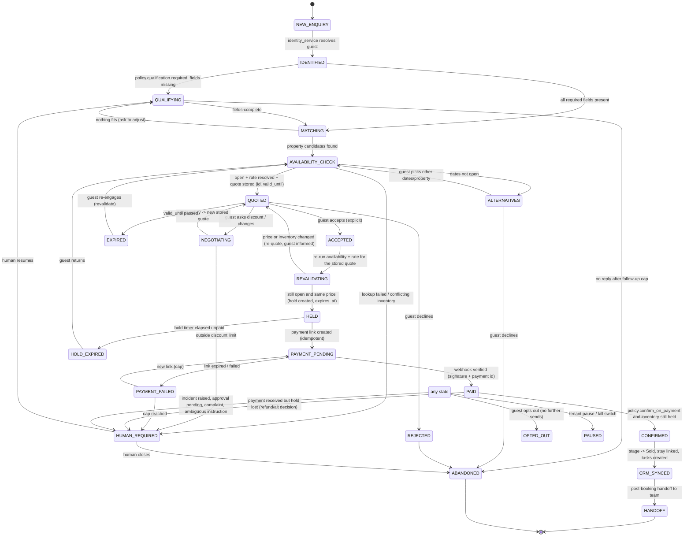

# Sales Agent — technical design (proposal)

Status: **proposal for review. Nothing here is built.** Depends on `SALES_AGENT_CURRENT_STATE.md`. Implementation is split into small increments in `SALES_AGENT_PLAN.md`.

## 1. Principles

1. **One product, three autonomy levels.** Copilot, Sales Assistant and End-to-End Agent are *presets over the same capability switches*, not separate code. A preset only fills in a policy; the server enforces the policy.
2. **The model decides what to say and which step is next. Code decides what is true and what is allowed.** Rates, availability, booking state, payment state and consent come only from the authoritative services. The model never supplies a price, a date result, a booking id or a payment status; it can only *propose an action from a fixed list*, naming records by id.
3. **A single choke point.** Every side effect (send, quote, hold, booking, payment link, CRM write) goes through an **Action Gateway** that checks policy, dependencies, permission, consent, risk tier and idempotency *before* calling the existing service. Prompts, frontend toggles and model output carry no authority.
4. **Safe by default.** A new tenant is Copilot with every high-impact capability off. A capability is *available* only when policy allows it **and** its dependencies verify (integration connected, properties with rates, payment keys valid, permission granted) **and** the agent is not paused.
5. **Reuse first** (see current-state §3). New tables only where the audit showed nothing to extend.

## 2. Architecture

```
inbound WA/IG ─► identity_service ─► conversation/inquiry (existing)
                                   │
                                   ▼
                       SalesWorkflow (durable state, per lead)  ◄── timers / webhooks / human actions
                                   │ 1. build facts (code): availability, quote, booking, payment, consent, policy
                                   ▼
                       Planner (get_llm, one structured call) ──► AgentDecision {reply_text, next_step, proposed_actions[ids only]}
                                   │
                                   ▼
                       Action Gateway ── policy ∩ dependencies ∩ permission ∩ consent ∩ risk ∩ idempotency
                          │            │                    │
                       execute      needs approval       blocked
                          │            │                    │
              existing services   ActionProposal       AgentIncident (+ human task/push)
   (calculator, booking, razorpay, inquiry, send_*)   (bound to exact params hash)
                                   │
                          append_audit (hash chain) + workflow event log
```

Why a single structured call and not a tool loop: `get_llm().complete()` returns only the first tool call and has no message history or tool-result round trip (current-state row 1). The planner therefore receives *all facts in the prompt* and returns one decision per turn. This matches the existing concierge, needs no adapter change, works on NVIDIA or Gemini, and makes every turn reproducible from stored inputs.

### 2.1 Components and what is new

| Component | Reuses | New |
|---|---|---|
| Policy store + resolver | `Tenant` AI columns (kept as the reply-mode source), `authz_service`, `append_audit` | table `sales_agent_policies` (versioned) — nothing versioned exists |
| Capability evaluator | integration health (`integration_health.py`), `authz_service` | pure function `effective_capabilities(tenant)` |
| Action Gateway | `inquiry_service`, `booking_service`, razorpay adapter, `send_*` tasks, `task_service` | module `services/agent_gateway.py` |
| Action proposals | – | table `agent_action_proposals` (parameter-bound approval) |
| Workflow | Celery + `acks_late`, webhook-outbox retry pattern | tables `sales_workflows`, `sales_workflow_events` — flows persist only at delay nodes and swallow errors |
| Quote record | `InquiryQuote` (exists, never written) | columns: property, dates, party, breakdown JSON, `params_hash`, `valid_until`, `status` |
| Incidents | `task_service`, `push_service` for the human side | table `agent_incidents` — the existing `Incident` is a DPDP breach register |
| Control centre | permissions page diff-then-save pattern | policy page, activation modal, history tab |

## 3. Workflow state machine

States describe where the *lead* is; each transition is made by code after a gateway-approved action or an authoritative event. The model proposes; it never sets a state.



### 3.1 Persistence and resumption

- `sales_workflows` (one open row per lead/conversation): `state`, `context` (ids of the current quote, hold, stay, payment link; *no free-text facts*), `version` (optimistic lock), `next_wake_at`, `paused`, `opted_out`.
- `sales_workflow_events` (append-only): `event_id` **unique per (tenant, source, source_event_id)** — the inbound message id, webhook payment id or timer id. A duplicate delivery inserts nothing and is dropped. Each row stores the transition, the gateway verdict and the idempotency key used.
- A step runs in one transaction: lock workflow row → verify state/version → gateway → write event + state → enqueue the *effect* (send task) from an outbox row in the same transaction. A crash before commit leaves nothing; after commit the outbox (re-driven every minute, like `webhooks.retry_due`) finishes the effect. A reaper reclaims rows stuck mid-step.
- Timers (`next_wake_at`) drive quote expiry, hold expiry, payment-link expiry and follow-ups; one beat task reads due workflows.

### 3.2 Facts the agent may state, and their source

| Fact | Authoritative source | Model may… |
|---|---|---|
| Open dates, why not open | `calculator_service.availability_report` | quote the result in words |
| Price | stored quote (`InquiryQuote`: id, params hash, `valid_until`) | repeat the stored figures only (existing exact-number guard) |
| Booking exists / state | `Stay` + ledger | describe it |
| Payment received | verified webhook → `StayPayment` | never claim before the ledger row exists |
| Consent | `Consent` / opt-out state | – |
| "Booked/confirmed" wording | only after state ∈ {CONFIRMED, CRM_SYNCED} | – |

Guard: any reply that claims success (booking confirmed, payment received, hold placed) is blocked unless the workflow state and the authoritative record agree. Same shape as the existing availability and price guards.

### 3.3 Booking, hold and money states (distinct)

`quote` (no inventory held) → `hold` (inventory reserved, `expires_at`, unpaid) → `pending_payment` (link issued) → `paid` (ledger) → `confirmed` (Stay confirmed) ; side exits `failed`, `cancelled`, `expired`. Two implementation options for the hold, decision **D2**:

- **Option A (recommended): extend `BlockedDate`** (`reason="agent_hold"`, `expires_at`, `workflow_id`). Already honoured by availability, iCal export and the calendar; no effect on revenue/occupancy metrics. Stay is created only when payment is verified (or at acceptance under a stricter policy).
- Option B: new `Stay.status = pending_payment`. Matches the booking page but touches every status filter (KPI metrics, occupancy, public API) and needs the payment-link endpoint's per-Stay assumption removed.

A blocked-dates endpoint gap exists today (no role gate); it is fixed in I-0 before the agent depends on it.

### 3.4 Idempotency and reconciliation

- Every gateway action carries `idempotency_key = hash(tenant, workflow_id, step, params_hash)`; `agent_action_proposals` has a unique index on `(tenant_id, idempotency_key)`. Replays return the stored result.
- Booking creation gets a real idempotency key and runs `find_conflicts` (today it does neither); payment-link creation stores the key on the link and reuses an unexpired link for the same purpose.
- Hourly **reconciliation** job: compare workflows in PAYMENT_PENDING/PAID with Razorpay link status and the ledger; paid-without-confirmation, confirmed-without-payment and expired-hold-with-payment raise incidents. Nothing is auto-refunded.

## 4. Policy and configuration schema (proposal)

Stored in `sales_agent_policies(tenant_id, version, status: draft|active|superseded, config JSONB, created_by, activated_by, created_at, activated_at, note)`; one `active` row per tenant (partial unique index). Validated by a Pydantic model on write; changes appended to the audit chain (`agent_policy.draft_saved`, `.activated`, `.paused`, `.resumed`). Rolling back = activating a prior version.

```jsonc
{
  "schema_version": 1,
  "autonomy": {
    "mode": "copilot",                    // copilot | assistant | end_to_end  (preset; capabilities below are the truth)
    "paused": false,                      // tenant pause; also honoured: Tenant.ai_kill_switch
    "channels": {"whatsapp": true, "instagram": false}
  },
  "capabilities": {                       // each default false; each has declared dependencies
    "auto_reply":            {"enabled": false, "min_confidence": 0.78},
    "qualification":         {"enabled": false, "required_fields": ["dates","adults","property_or_route","phone"]},
    "property_recommendation":{"enabled": false, "max_options": 3},
    "quote_disclosure":      {"enabled": false, "mode": "handoff"},   // handoff (Ratha) | grounded; was brand_config.price_disclosure
    "negotiation":           {"enabled": false, "max_discount_percent": 0, "max_discount_amount": 0, "floor_rule": "never_below_base_rate", "approval_above": 0},
    "follow_ups":            {"enabled": false, "max_attempts": 2, "gap_hours": [24, 72], "quiet_hours": {"start":"21:00","end":"09:00"}, "stop_on_opt_out": true},
    "booking_hold":          {"enabled": false, "ttl_minutes": 60, "max_active_holds": 3},
    "booking_creation":      {"enabled": false, "require_payment_first": true},
    "payment_link":          {"enabled": false, "max_amount": 0, "advance_percent": 30, "expiry_hours": 48, "max_links_per_workflow": 2},
    "booking_confirmation":  {"enabled": false, "confirm_on": "payment_verified"},
    "cancellation":          {"enabled": false, "mode": "human_only"},   // never autonomous by default
    "refund":                {"enabled": false, "mode": "human_only"}    // never autonomous by default
  },
  "approvals": {                          // risk-based gates; the approval is bound to the exact params hash
    "default_for_tier": {"T3_inventory": "approve", "T4_money": "approve"},
    "expiry_minutes": 30,
    "approver_roles": ["owner", "manager"]
  },
  "escalation": {
    "destinations": {"default": {"roles": ["manager"], "push": true, "whatsapp_number": null},
                     "payment": {"roles": ["owner"]}},
    "severity_sla_minutes": {"critical": 10, "high": 30, "medium": 120, "low": 480},
    "complaint_keywords_extra": []
  },
  "limits": {"max_agent_messages_per_conversation_hour": 6, "max_active_workflows": 200}
}
```

### 4.1 Presets (what "mode" fills in)

| Capability | Copilot | Sales Assistant | End-to-End |
|---|---|---|---|
| Drafts for a human | on | on | on |
| auto_reply (within guards) | off | on | on |
| qualification, property recommendation | suggest only | on | on |
| quote_disclosure | off (human) | tenant choice | on if `grounded` |
| negotiation within limits | off | off | tenant choice (limits mandatory) |
| follow_ups | off | on | on |
| booking_hold | off | approval | auto within `max_active_holds` |
| payment_link | off | approval | auto within `max_amount` |
| booking_creation / confirmation | off | approval | auto only after payment verified |
| cancellation / refund | off | human only | human only unless the owner opts in explicitly |

Selecting a preset only proposes values; the owner reviews the preview and activates. Ratha stays `quote_disclosure.mode = handoff` as a *tenant* value.

### 4.2 Effective capability = policy ∩ dependencies ∩ permission ∩ state

`effective_capabilities(tenant)` returns, per capability: `enabled_in_policy`, `available` (dependencies verified), `active` (policy active, not paused, kill switch off), and `blocked_reasons[]`. The UI renders exactly this result; the gateway calls the same function. Dependencies, for example:

| Capability | Requires |
|---|---|
| auto_reply | WhatsApp/IG integration healthy; AI mode on that channel not `off`; LLM route reachable |
| quote_disclosure=grounded | ≥1 active property with an active rate plan; `calculator_service` returns a quote for a probe |
| booking_hold | availability service healthy; calendar sync not in error |
| payment_link | Razorpay integration `active`, keys validated, webhook secret set; booking_creation or hold enabled |
| booking_confirmation | payment_link enabled; webhook reachable (recent verified event or test ping) |
| follow_ups | consent check wired; WhatsApp template approved for out-of-window |

## 5. Tool permission matrix

Risk tiers: **T0** read · **T1** reversible message to the guest · **T2** commercial disclosure · **T3** inventory commit · **T4** money / irreversible. "Approval" = default; the policy may relax T3/T4 only with explicit limits.

| Tool (gateway action) | Tier | Policy flag | Backed by (existing) | Requires | Default | Idempotency key | On failure |
|---|---|---|---|---|---|---|---|
| `lookup_availability` | T0 | – | `availability_report` | tenant scope | auto | – | incident `integration_failure` after 2 tries; reply "team will confirm" |
| `build_quote` (store) | T0 | quote_disclosure | `build_quote` → `InquiryQuote` | availability open | auto | (workflow, dates, party, property) | `invalid_pricing` |
| `send_reply` | T1 | auto_reply | `send_whatsapp/instagram_dm` | consent, window/template, confidence, guards | auto if enabled | message id | draft only |
| `disclose_quote` | T2 | quote_disclosure=grounded | stored quote figures | quote valid | auto if grounded | quote id | block + `pricing_policy` |
| `apply_discount` | T2 | negotiation | – (new, computed) | within limits | auto within limits, else approve | (quote id, % ) | `discount_violation` |
| `create_hold` | T3 | booking_hold | `BlockedDate(agent_hold)` | quote valid, revalidation ok | approve (assistant) / auto (e2e) | (workflow, quote id) | `inventory_conflict` |
| `create_payment_link` | T4 | payment_link | razorpay adapter | hold active, amount ≤ max | approve (assistant) / auto (e2e) | (workflow, purpose) | `payment_failure` |
| `create_booking` | T3 | booking_creation | `Stay` + `find_conflicts` (to be added) | conflict check passes | approve | (workflow, quote id) | `inventory_conflict` |
| `confirm_booking` | T3 | booking_confirmation | `Stay.status` | payment verified | auto if e2e | (stay id, payment id) | `payment_booking_mismatch` |
| `update_crm` | T1 | – | `inquiry_service` (stage Sold etc.), `update_lead_fields` allow-list | AI actor identity | auto | (inquiry, stage) | log + task |
| `create_task` / `notify_team` | T0 | – | `task_service`, `push_service` | – | auto | (workflow, reason) | – |
| `schedule_follow_up` | T1 | follow_ups | beat timer + `send_reply` | consent, quiet hours, attempts cap | auto | (workflow, attempt no.) | skip + log |
| `cancel_booking` / `refund` | T4 | cancellation/refund | – | human only | **never autonomous** | – | `unauthorized_tool` |
| anything not listed | – | – | – | – | **denied** | – | `unauthorized_tool` |

AI actor: a service identity per tenant (`agent:<tenant>`) so stage moves and field writes have an `actor` for `inquiry_service` and the audit chain; it holds only the capabilities the policy grants and is excluded from the interactive role matrix.

## 6. Incidents and human escalation

Table `agent_incidents`: `id, tenant_id, workflow_id, conversation_id, inquiry_id, type, severity, triggering_event (jsonb ref), attempted_action (tool + params_hash), reason, status (open|acknowledged|resolved|dismissed), owner_user_id, due_at (SLA), created_at, acknowledged_at, resolved_at, retry_history (jsonb), resolution_note`. Each incident also creates a `Task` and a push to the policy's destination for that type, and an audit row. It is distinct from the DPDP `Incident`.

| Type | Trigger | Severity | Automatic action | Default owner | SLA (min) |
|---|---|---|---|---|---|
| `inventory_conflict` | revalidation shows dates taken / overlapping hold | high | stop workflow → HUMAN_REQUIRED, tell guest the team will confirm | reservations | 30 |
| `invalid_pricing` | no rate, quote expired, stored vs live differ | high | re-quote or hand off; never state a figure | manager | 30 |
| `discount_violation` | request/proposal outside limits | medium | refuse politely, offer human | manager | 120 |
| `payment_booking_mismatch` | paid without hold/booking, booking without payment, amount differs | critical | freeze workflow, no refund automatically | owner | 10 |
| `payment_failure` | link create error, expired/failed link, webhook signature failure | high | retry per cap, then human | owner | 30 |
| `integration_failure` | availability/rates/calendar/Razorpay/WhatsApp down | high (critical if paying) | pause affected capability, "team will confirm" reply | manager | 30 |
| `ambiguous_instruction` | acceptance unclear, conflicting dates/party | low | ask one clarifying question; after 2 asks → human | agent on duty | 480 |
| `complaint` | complaint/refund/legal/safety intent (existing `escalation_policy`) | high | hold sends, push "needs a human now" | manager | 30 |
| `unauthorized_tool` | model proposes an action outside policy/list | high | block; log proposal; count toward auto-pause | owner | 60 |
| `consent_violation_blocked` | send attempted to an opted-out guest | medium | block | compliance | 120 |
| `prompt_injection_suspected` | guest text instructs the agent (ignore rules, change price, reveal data) | medium | treat as data, continue normally, flag | manager | 480 |

**Auto-pause:** ≥ N `unauthorized_tool`/`payment_booking_mismatch` incidents in an hour, or a spike of rejected drafts, pauses the tenant's agent (policy `paused=true`) and raises a critical incident. Resuming is a human action.

### 6.1 Approvals bound to exact parameters

`agent_action_proposals(id, tenant_id, workflow_id, tool, params jsonb, params_hash, tier, status proposed|approved|rejected|executed|failed|expired, proposed_by (agent|user), approver_user_id, approved_at, expires_at, idempotency_key, result jsonb)`.
Execute verifies `sha256(canonical(params)) == params_hash` and `status == approved` and `now < expires_at`, then runs *the stored params*, never request-supplied ones. Changing any parameter creates a new proposal and invalidates the old one. The approval UI shows the exact property, dates, party, amount, message text and the stored quote id.

## 7. Prompt-injection and malformed-output stance

- Guest text is data in a delimited block; the planner prompt contains no secrets, no tool credentials and no instruction authority beyond the system block.
- The planner may only name tools from the enumerated list and reference records by id; any unknown tool, any id not belonging to the tenant/workflow, or any parameter that differs from the stored quote is rejected by the gateway (`unauthorized_tool`).
- Output that is not valid against the `AgentDecision` schema is retried once, then degraded to a holding reply plus human review (existing behaviour).
- The deterministic guards from this branch (availability, exact-figure price, media-claim, escalation) run on every outgoing message.

## 8. Control centre (UI)

One settings area, "Sales agent", built on the permissions page's diff-then-save pattern:

1. **Mode cards** (Copilot / Assistant / End-to-End) — selecting one only fills the draft policy and shows what changes.
2. **Capability list** — each switch shows: policy state, *Available / Blocked (why)*, and its dependencies as a checklist with fix links (connect Razorpay, add a rate plan …). Blocked switches cannot be turned on.
3. **Policy panels** — pricing disclosure, negotiation limits, follow-ups and quiet hours, booking hold/creation/confirmation, payment limits, cancellations/refunds (human only), escalation destinations and SLAs.
4. **Preview & activate** — shows the resulting effective capabilities and a plain-language list ("will message guests on WhatsApp", "will place date holds", "will create payment links up to ₹X"); activation requires typing the tenant name for high-impact capabilities. Saved ≠ active: the header always shows *Saved (v7)* vs *Active (v6)* and a `Shadow / Live` badge.
5. **Pause / resume** — one button, always visible, no confirmation to pause; confirmation to resume.
6. **History** — policy versions with author, time, diff and one-click "restore as draft"; backed by the audit chain.
7. **Incidents & approvals inbox** — open incidents by severity/SLA; pending proposals with exact parameters.

Warnings are shown before enabling any capability that messages guests externally, places holds/creates bookings, or initiates payment.

## 9. Rollout stages (per tenant, explicit opt-in)

0. **Off** (default). 1. **Shadow / dry-run**: the workflow runs end to end, every proposed action is recorded and *not executed*; humans compare with what they did. 2. **Copilot-assisted**: drafts and suggested actions, humans execute. 3. **Partial automation** (Assistant): low-tier actions auto, T3/T4 by approval. 4. **End-to-end** only after the acceptance gates in the plan pass for that tenant (decision agreement, zero guard bypasses, zero unreconciled payments over a defined window).

## 10. Decisions needed from the owner

| ID | Decision | Recommendation |
|---|---|---|
| D1 | Where AI autonomy lives: keep `Tenant.*_ai_mode_default` as the reply gate and add the policy for everything else | yes — avoids migrating a working gate |
| D2 | Hold mechanism (§3.3) | Option A, `BlockedDate` with expiry |
| D3 | Does a paid link confirm the booking automatically | only when `booking_confirmation` is enabled and hold still valid |
| D4 | Refund / cancellation autonomy | human only for v1 |
| D5 | Instagram as an autonomous-sales channel | after the Instagram opt-out path exists |
| D6 | Provider for the planner (Gemini billing is blocked today; concierge runs on NVIDIA) | decide before shadow mode; evaluate both on the acceptance set |
